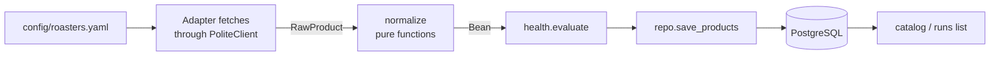

# beantracker

[](https://github.com/Nadavsim/beantracker/actions/workflows/ci.yml)

Scrapes specialty coffee roasters, normalizes their products into one searchable catalog, and
keeps a price and stock history for every size, so "what is new" and "what changed price" are
questions you can ask the database.

Python 3.12, PostgreSQL, SQLAlchemy 2, Alembic, httpx, Typer. 282 offline tests, strict mypy.

**Status:** Phase 1 is done: four roasters (three Shopify shops configured in YAML, one custom
HTML scraper), a CLI, per-run health checks and a stored history. Not built yet: web UI, API,
alerts, scheduling. See [Limitations and roadmap](#limitations-and-roadmap).

## What it looks like

The catalog holds the latest price of every size. Sample from a live scrape on 2026-11-09,
filtered to one bean and sorted by price per 100 g:

```console
$ beantracker catalog --roaster hydrangea --origin Ethiopia --process natural --in-stock --limit 3
                                                       Catalog: 3 sizes
┌───────────┬────────────────────────────┬────────┬────────────┬───────┬───────┬───────────────────┬──────────────────┬───────┐
│ Roaster   │ Name                       │ Size   │ Price      │ /100g │ Stock │ Origin            │ Process          │ Roast │
├───────────┼────────────────────────────┼────────┼────────────┼───────┼───────┼───────────────────┼──────────────────┼───────┤
│ hydrangea │ Landrace - Natural - Danc… │ 2270 g │ 110.00 USD │ 4.85  │ yes   │ Ethiopia, Gedeb   │ Natural          │ ?     │
│ hydrangea │ Landrace - Natural - Danc… │ 907 g  │ 77.00 USD  │ 8.49  │ yes   │ Ethiopia, Gedeb   │ Natural          │ ?     │
│ hydrangea │ Landrace - Natural - Danc… │ 227 g  │ 24.00 USD  │ 10.57 │ yes   │ Ethiopia, Gedeb   │ Natural          │ ?     │
└───────────┴────────────────────────────┴────────┴────────────┴───────┴───────┴───────────────────┴──────────────────┴───────┘
```

Each scrape is a recorded run with a health verdict:

```console
$ beantracker scrape-all
nomena run 12: ok
  22 products, 44 sizes, 44 snapshots, 0 new, 0 delisted
september run 13: ok
  395 products, 418 sizes, 418 snapshots, 0 new, 0 delisted
hydrangea run 14: ok
  372 products, 990 sizes, 990 snapshots, 0 new, 0 delisted
dak run 15: ok
  21 products, 21 sizes, 21 snapshots, 0 new, 0 delisted
```

## Quick start

You need [uv](https://docs.astral.sh/uv/) (it installs Python 3.12 for you) and Docker for
PostgreSQL.

```bash
git clone https://github.com/Nadavsim/beantracker
cd beantracker
uv sync
docker compose up -d db
uv run beantracker db upgrade
uv run beantracker scrape-all          # about a minute: DAK alone makes 20+ polite requests
uv run beantracker catalog --in-stock --limit 10
```

The defaults match `docker-compose.yml`, so no configuration is needed. To override, copy
`.env.example` to `.env` or set environment variables: `DATABASE_URL`, `USER_AGENT`,
`REQUEST_DELAY_S`, `CACHE_DIR`, `CACHE_TTL_HOURS`, `MAX_CRAWL_DELAY_S`.

## Commands

| Command | What it does |
| --- | --- |
| `scrape <slug> --no-store` | Fetch live and print what would be stored. Writes nothing; the manual check for an adapter. `--cache` reuses pages for a few hours (only allowed here) |
| `scrape <slug>` | One stored run. `--strict` also fails on warnings; `--reset-baseline` accepts a new catalog size |
| `scrape-all` | Every roaster, concurrently (`--concurrency`, default 4), sharing one per-host throttle. One failing roaster does not stop the others |
| `catalog` | Search stored data: `--roaster --origin --process --search --in-stock --delisted --currency --limit`. Sorted by price per 100 g within each currency; `--limit` is per currency |
| `runs list` | Recent runs with status, product count, missing-field rate and health flags |
| `db upgrade` | Apply Alembic migrations |

Exit codes: `0` all runs ok (warnings too, unless `--strict`), `1` a run failed, `2` the command
was wrong (unknown slug, unreadable or invalid config, unknown adapter, misspelled option).

## How it works



Four rules shape the code:

1. **Adapters fetch, normalization interprets, the repository stores, health checks judge.**
   Nothing does another stage's job. Adapters return `RawProduct` (strings exactly as the site
   wrote them, plus the source payload); `normalize()` turns them into typed `Bean`s and is a pure
   function, so it is tested with plain inputs and no network.
2. **Unknown stays `None`.** Two countries in one title, no roast wording, an unparseable price:
   each gives an empty value or a skipped size, never a guess.
3. **The data model is snapshot-based.** `coffee` is a product's identity, `offer` is one size,
   and `offer_snapshot` is an append-only observation of price and stock per run. A "new lot" is
   a coffee first seen in this run; price history is an offer's snapshots; a delisted coffee is
   one absent from the latest healthy run. All are queries, with no special-case logic. Money is
   stored as integer minor units plus a currency, never floats.
4. **Scraping is polite and checked.** See below.

### Polite scraping

- A descriptive User-Agent that links to this repo.
- robots.txt handled per RFC 9309: user-agent groups, `*` and `$` wildcards, longest match wins.
  The standard library parser ignores wildcards, so this is its own matcher. A robots.txt that
  cannot be read (server error, rate limit, access denied, network failure) means the site is off
  limits.
- `Crawl-delay` is honoured per host (a delay above 30 s makes the site off limits, with a clear
  reason, rather than being quietly ignored).
- At least 2 s between requests to the same host, shared across concurrently scraped roasters.
- Redirects are followed by hand, so every hop is robots-checked and throttled for the host it
  lands on.
- Retries with backoff for network errors and 429/5xx; `Retry-After` is honoured up to 60 s.
- No login-walled content. The disk cache exists only for iterating on parsers and can never
  feed the database.

### Health checks

Scrapers rarely crash when a site changes; they quietly return less. Each run is compared with the
median of the last five healthy runs:

| Flag | Meaning | Status |
| --- | --- | --- |
| `zero_products` | nothing was found | failed |
| `count_drop` | product count fell more than 40% | warning |
| `missing_fields` | over 30% of sizes lack a required field (in practice, a weight) | warning |
| `coverage_drop:<field>` | a normally well-filled field (origin, process, ...) lost 30+ points | warning |

Runs that error out, are interrupted (Ctrl+C) or die are recorded too, never left as
`running`. After a roaster really changes its catalog size, `scrape <slug> --reset-baseline`
accepts the new normal.

## Roasters

| Slug | Site | Kind | Notes |
| --- | --- | --- | --- |
| `nomena` | Nomena Roasters (Israel) | Shopify, ILS | Hebrew titles; a `-light` handle suffix means a lighter roast |
| `september` | September Coffee | Shopify, USD | Whole back catalog is listed, mostly sold out. Its feed has no descriptions, so the origin, process and roast level of in-stock coffees are read from their product pages |
| `hydrangea` | Hydrangea Coffee Roasters | Shopify, USD | Sizes in ounces; the site's own `grams` field is unreliable |
| `dak` | DAK Coffee Roasters | WooCommerce HTML, EUR | Custom adapter; only the default size is priced |

### Adding a roaster

A Shopify shop is configuration, not code. Add an entry to `config/roasters.yaml`:

```yaml
- slug: example
  name: Example Roasters
  base_url: https://example.com
  adapter: shopify
  currency: USD          # Shopify's /products.json carries no currency, so state it
  options:               # validated: a misspelled key is an error, not silently ignored
    exclude_product_types: [gear]
    exclude_title_keywords: [gift card]
    min_price: 3
    roast_from_handle: {"-light": light}
    # if the feed has no description, read each in-stock product page (theme-specific parser)
    details_from_pages: {parser: parameter_list, only: in_stock}
```

Check it with `beantracker scrape example --no-store`. A site that is not Shopify needs an
adapter: implement `fetch() -> list[RawProduct]` (see `adapters/dak.py`) and register it in
`adapters/registry.py`.

## Project layout

```
config/roasters.yaml     the roasters: slug, site, adapter, currency, options
migrations/              Alembic migrations
src/beantracker/
  cli.py                 Typer commands
  config.py              settings and roaster config models
  runner.py              one scrape run: record, fetch, judge, store
  health.py              run health checks
  repo.py                all database writes, plus catalog / delisted queries
  models/orm.py          the SQLAlchemy tables
  domain/                RawProduct (adapter output) and Bean (normalized output)
  adapters/              base protocol, registry, generic Shopify adapter, DAK
  normalize/             weight, price, origin, process/roast, and the pipeline
  http/                  PoliteClient, robots.txt matcher, per-host throttle
tests/                   282 tests; fixtures/ holds real captured pages and feeds
```

## Development

```bash
uv run ruff check . && uv run ruff format --check .
uv run mypy                    # strict
uv run pytest                  # needs the Postgres container for the integration tests
uv run pytest -m "not integration"   # offline unit tests only
```

Adapter tests run against saved pages and feeds in `tests/fixtures/`, never live sites, so they
are deterministic and offline. Database tests use a throwaway `beantracker_test` database and
check, among other things, that the migrations produce exactly the schema the models describe.
CI runs lint, the format check, mypy and the full suite against a Postgres service.
`CLAUDE.md` records conventions and the gotchas found along the way.

## Limitations and roadmap

- **Prices are not converted between currencies** (exchange rates change and cannot be checked
  offline). The catalog ranks each currency on its own: it sorts, and applies `--limit`, within
  each currency, says so when a list mixes currencies, and `--currency` compares like with like.
  A true cross-currency ranking would need exchange rates.
- **DAK shows only the default size's price**, because the other sizes need WooCommerce's Store
  API.
- **Origin and process depend on what a roaster writes.** September's in-stock coffees are read
  from their product pages, but its sold-out back catalog only has what the title says, so about
  61% of all its sizes have an origin (2026-11-09).
- **Sold-out coffees are kept**, as some roasters list their whole back catalog; use `--in-stock`.
- Not built yet: scheduled scraping, a Dockerfile, a web UI and API, alerts for new lots that
  match your criteria. The data model already supports them (new-lot and delisting queries, a
  first-run `baseline` flag).
